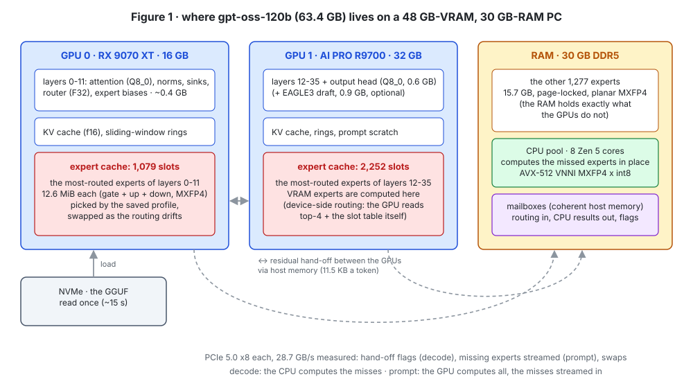
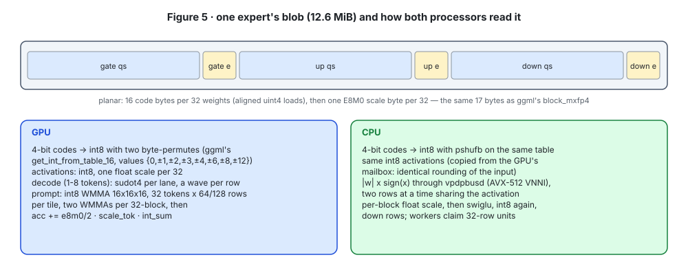
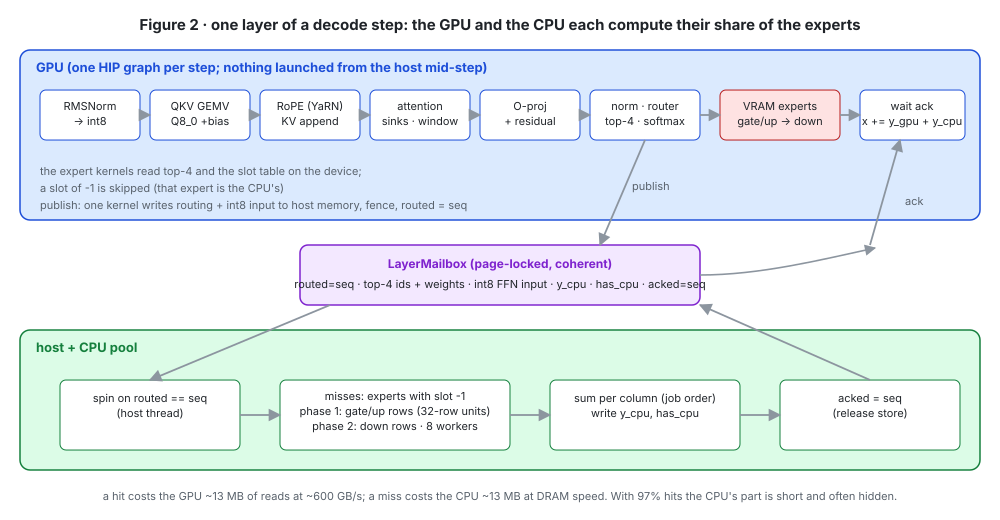
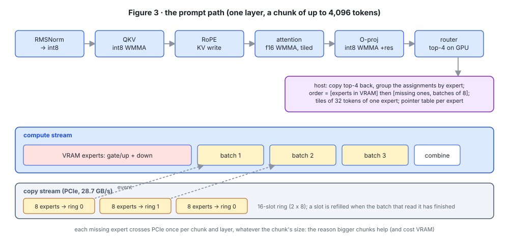
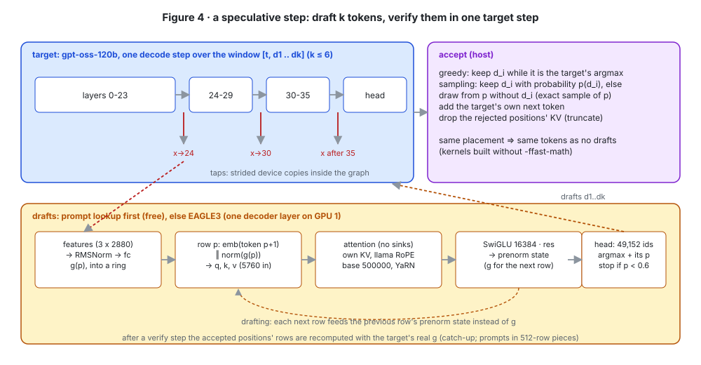
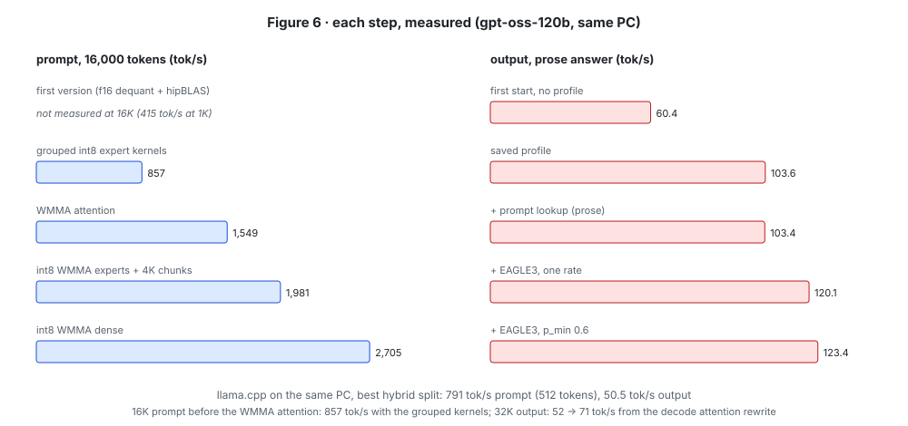

# Running gpt-oss-120b on one desktop PC: expert tiering, a GPU/CPU hand-off without host launches, and cheap speculation

*A research write-up of the strata-oss port. Every number below was measured on the PC described in §2.3; the
step-by-step log with each measurement is [../FINDINGS.md](../FINDINGS.md). Figures are generated by
[make_figures.py](make_figures.py).*

---

## Abstract

gpt-oss-120b is a 117-billion-parameter mixture-of-experts (MoE) model whose weights take 63.4 GB in their native
MXFP4 format. We run it on a desktop PC with 48 GB of VRAM split across two consumer GPUs and only 30 GB of system
RAM, a machine on which the model fits in neither memory alone. We port the mechanism of Strata, an engine built for
Qwen3.8-Flash-Next, to gpt-oss: the dense weights and the *most frequently routed* experts live in VRAM, the
remaining experts live in page-locked RAM where the CPU computes them in place, and the GPU decides on the device
which experts it computes, so the host never has to launch work in the middle of a layer. A token's GPU and CPU
halves meet through flags in coherent host memory. Prompts take a different path: the GPU computes every expert,
streaming the missing ones over PCIe behind the computation of the cached ones. Speculative decoding uses free
prompt-lookup drafts and a trained EAGLE3 draft model with a reduced vocabulary and confidence-based stopping, and
leaves greedy output token-for-token unchanged.

On a Ryzen 7 9800X3D with an RX 9070 XT 16 GB and a Radeon AI PRO R9700 32 GB, the engine writes 91-101 tokens/s
(116-131 with EAGLE3) and reads prompts at 1,800-2,700 tokens/s. llama.cpp's best hybrid configuration on the same
machine writes 50.5 tokens/s and reads 791. We describe the design, the measurements that drove each decision (including
the ones that failed), the bottlenecks that remain (PCIe at 28.7 GB/s per card), and the pitfalls we hit.

---

## 1. Introduction

### 1.1 The problem

A dense 120B model needs every weight for every token, so it is memory-bandwidth-bound on whatever device holds the
weights. An MoE model like gpt-oss-120b is different: each layer has 128 experts, a router picks 4 of them per
token, and those 4 are the only expert weights the token touches. 5.1B of the 117B parameters are active per token.
In principle, then, the model does not need all of its weights in fast memory. It needs the ones it actually uses,
in fast memory, when it uses them.

The machine we target cannot hold the model anywhere in one piece:

| | capacity | holds the 63.4 GB model? |
| --- | ---: | --- |
| VRAM (two GPUs) | 16 + 32 = 48 GB | no |
| system RAM | 30 GB (≈27 GB free) | no |
| VRAM + RAM | ≈75 GB usable | yes, barely |

So the weights must be *split* across the GPUs and RAM, and every token must be computed where its weights are.

### 1.2 What existing engines do

llama.cpp's hybrid mode (`--n-cpu-moe N`) keeps the experts of the first N layers on the CPU and everything else on
the GPUs. The split is by *layer*: in those N layers, all four experts of every token run on the CPU. On our PC the
best configuration that fits (`-ncmoe 10 -ts 17/19`) writes 50.5 tokens/s.

Strata, written for Qwen3.8-Flash-Next (48 layers × 512 experts, top-10), splits by *expert* instead. Routing is
skewed: a minority of experts carry most of the routings. Strata ranks the (layer, expert) pairs by measured routing
frequency, fills VRAM with the top of that ranking, computes the rest on the CPU from RAM at the same time as the GPU
computes the cached ones, and keeps adapting the ranking to the conversation.

### 1.3 Contributions

1. A port of Strata's expert tiering to the gpt-oss architecture: sinks, sliding-window layers, YaRN RoPE, MXFP4
   experts with biases, and the clamped SwiGLU. It is a separate engine, so the Qwen engine is untouched.
2. A decode step in which the GPU decides, on the device, which experts it computes. The CPU's share meets it through
   sequence-numbered flags in coherent host memory, so a whole step is one pre-recorded GPU graph per card (§3.3).
3. A prompt path that computes all experts on the GPU, with grouped int8 kernels (WMMA on RDNA4), streaming the
   missing experts through a ring behind the cached ones (§3.4).
4. Speculative decoding sized by measured verify costs: free prompt-lookup drafts plus an EAGLE3 draft model with a
   49,152-token draft vocabulary and confidence stopping. Greedy output is token-identical (§3.6).
5. A measurement methodology for a model whose own reference implementation disagrees with itself on 7% of tokens
   (§4.1), and an account of the bottlenecks and pitfalls (§5, §6).

---

## 2. Background

### 2.1 The gpt-oss architecture

| | gpt-oss-120b | gpt-oss-20b |
| --- | ---: | ---: |
| layers | 36 | 24 |
| hidden size | 2,880 | 2,880 |
| attention | 64 query heads, 8 KV heads, head dim 64 | same |
| experts per layer / used per token | 128 / 4 | 32 / 4 |
| expert FFN width | 2,880 | 2,880 |
| vocabulary | 201,088 (o200k_harmony) | same |
| weights (GGUF, MXFP4 experts, Q8_0 rest) | 63.4 GB | 12.1 GB |

The details that matter for an implementation (checked against llama.cpp's `openai-moe` graph):

- **Alternating attention:** even layers attend over a sliding window of 128 tokens (a key is visible iff
  `q_pos - k_pos < 128`), odd layers over the whole context.
- **Attention sinks:** one learned logit per head joins every softmax denominator and contributes no value:
  `softmax([scores, sink])` with the sink column dropped.
- **YaRN RoPE** with factor 32 over an original context of 4,096, base 150,000, NeoX pairing (dimension i with
  i + 32). The YaRN magnitude correction `1 + 0.1 ln 32 ≈ 1.347` multiplies cos and sin. llama.cpp cancels its
  separate attention factor so that this correction is applied exactly once.
- **Biases** on q, k, v, the output projection, the router and every expert matrix.
- **Routing:** top-4 of the router logits, then a softmax over just those four (not over all 128).
- **Clamped SwiGLU:** `g = min(g, 7)`, `u = clamp(u, −7, 7)`, `out = g · σ(1.702 g) · (u + 1)`.
- **MXFP4 experts:** blocks of 32 weights, each a 4-bit E2M1 code plus one shared E8M0 power-of-two scale (17 bytes
  per 32 weights). Everything else is Q8_0; the router is F32.

One expert (gate, up, down) is 3 × 2,880 × 2,880 weights = **12.6 MiB**. The 120b's 4,608 experts total 58 GB; the
dense part (attention, norms, router, biases) is ~1 GB, plus 0.6 GB each for the embedding and the output head.

### 2.2 Strata's mechanism (as built for Qwen)

Strata keeps attention, routers, shared experts, the head and the KV cache on the GPU, plus an *expert cache*
that fills the rest of VRAM with the most-routed experts. All experts are in RAM; for each token the CPU computes the
ones the GPU does not hold, in place (AVX-512/AVX2 kernels), concurrently with the GPU. Prompts are read in large
chunks with experts streamed over PCIe. The cache adapts during a conversation, and its ranking is saved as a profile.
Speculation uses the model's own MTP layer. gpt-oss has none, which is why §3.6 needs other drafters.

### 2.3 The test machine

| | |
| --- | --- |
| CPU | AMD Ryzen 7 9800X3D, 8 cores / 16 threads, AVX-512 (VNNI), 96 MB L3 |
| RAM | 30 GB DDR5; `/tmp` is a 16 GB tmpfs and swap is zram (both compressed RAM) |
| GPU 0 | AMD Radeon RX 9070 XT, 16 GB, gfx1201 (RDNA4), PCIe 5.0 x8 |
| GPU 1 | AMD Radeon AI PRO R9700, 32 GB, gfx1201 (RDNA4), PCIe 5.0 x8 |
| software | Linux (CachyOS), ROCm 7.2, hipcc / clang 22 |
| reference | llama.cpp 5e03bdd87 built with HIP on the same machine |

Measured host-to-device bandwidth from pinned memory: **28.7 GB/s on each card**.

---

## 3. Design

### 3.1 Placement: who holds what



**Layer split.** Layers are assigned to GPUs in proportion to each GPU's free VRAM after reserving the output head
on the last GPU: layers 0-11 on the 16 GB card, layers 12-35 plus the head on the 32 GB card. The residual stream
(2,880 floats per token) crosses from one card to the other once per token, through host memory.

**Expert slots.** After the dense weights, KV caches and scratch buffers are allocated, each GPU's remaining VRAM
(less a 768 MiB reserve) is divided into 12.6 MiB *slots*. That came to 3,331 slots on the test PC, 72% of all
experts. A per-layer table maps each (layer, expert) to a slot or to −1.

**Which experts get slots.** Within each GPU's layers, the (layer, expert) pairs are ranked by routing frequency from
a *profile*: decayed routing counts that the previous run saved at exit. Without a profile the first start uses an
arbitrary set per layer and the adaptive tier (§3.5) fixes it. The profile is worth a lot: the first start of the 120b
wrote 60.4 tokens/s with 77% of routings hitting VRAM. Later starts from the matured profile wrote ~104 tokens/s at
97% hits.

**RAM.** Every expert without a slot is repacked at load time and copied into a page-locked arena (1,277 experts,
15.7 GB). The file's pages are dropped from the page cache layer by layer (`madvise`/`posix_fadvise`), so the OS cache
does not compete with the arena on a 30 GB machine. Loading reads the 63 GB file once, in ~15 s.

### 3.2 One data layout for both processors



ggml stores MXFP4 as 17-byte blocks (`e` then 16 code bytes), which makes 16-byte vector loads unaligned. At load time
each expert is repacked into one *planar blob*: for each of the three matrices, all code bytes (16 per block) and then
all scale bytes. The bytes are the same and only the order changes. Both processors read the same blob, so moving an
expert between RAM and a VRAM slot is a plain copy.

The dot products follow ggml's scheme. Activations are rounded to int8 with one float scale per 32 values. The 4-bit
codes become int8 through a lookup table of the doubled E2M1 values {0, ±1, ±2, ±3, ±4, ±6, ±8, ±12}: two byte
permutes on the GPU (`v_perm_b32`, as ggml-cuda's HIP branch does), `pshufb` on the CPU. Each block's integer sum is
scaled by `2^(e−127) / 2 × d_activation`. Crucially, the CPU receives the activation **already quantized by the GPU**
(through the mailbox, §3.3), so both processors start from identical int8 inputs.

### 3.3 The decode step: device-side routing and a flag hand-off



A token's layer is: RMSNorm → QKV projection (+bias) → RoPE, KV append → attention (sinks; window on even layers) →
output projection (+bias, +residual) → RMSNorm → router → top-4 → experts → residual. The question is how to split
the experts between the GPU and the CPU without stalling either.

**The naive approach** copies the router's choice to the host, synchronizes, and has the host launch the GPU's
expert kernels for the hits while the CPU computes the misses. That needs a host-side launch in the middle of every
layer, 36 of them per token, each paying launch latency. It also prevents recording the step as a graph.

**What we do instead:**

1. The expert kernels read the top-4 indices and the per-layer slot table *on the device*. An expert whose slot is −1
   is skipped. The GPU therefore computes all of its hits without the host knowing what they are.
2. A `publish` kernel writes the routing (indices, weights) and the int8-quantized FFN input into a per-layer
   *mailbox* in coherent, page-locked host memory. It then issues a system-scope fence and sets `routed = seq`, where
   `seq` is the step number.
3. The host thread spins on `routed == seq`, collects the misses, and has the CPU pool compute them. It writes the sum
   `y_cpu` and a per-column `has_cpu` flag, then `acked = seq` (a release store).
4. On the GPU, after its own expert kernels, a one-thread kernel spins on `acked == seq`. The residual kernel then adds
   `y_gpu + y_cpu`, reading `y_cpu` directly from host memory (11.5 KB).

Because nothing in the step depends on a host-side decision, each GPU's step is captured once as a HIP graph (per
number of columns, 1-8) and replayed. The step's positions and sequence number are in a parameter block that the
graph copies to the device as its first node. The two GPUs' graphs are launched together. GPU 1's first kernel waits
on a hand-off flag that GPU 0's last kernel sets, after writing the residual to host memory.

**The CPU pool** follows Strata's design. It has one worker per physical core, spinning while a request is running
and sleeping when idle, and each dispatch is a barrier. A layer's misses are split into 32-row units, claimed
dynamically: phase 1 is every missed expert's gate and up rows (followed by the SwiGLU and int8 rounding of each
32-row block), and phase 2 is the down rows. Results are summed per column in job order, so they are deterministic.
The inner kernel computes two rows at a time against one activation, with `vpdpbusd` (AVX-512 VNNI) on |w| and
sign-adjusted x.

**Cost model of a token.** A hit costs the GPU ~13 MB of reads at ~600 GB/s (~22 µs). A miss costs the CPU ~13 MB at
DRAM speed (~0.2 ms with 8 cores). At 97% hits a token has ~4 CPU misses spread over its 36 layers. Most of that
work runs while the GPU computes the hits, but a miss in a layer still delays that layer's residual add, which is why
the hit rate dominates decode speed.

### 3.4 The prompt path: everything on the GPU, misses streamed



A prompt chunk (4,096 tokens by default) routes to nearly every expert of every layer, so the CPU would be hopeless
there. Instead, the GPU computes all experts and streams the missing ones in:

1. **Dense part:** the RMSNorm output is rounded to int8 per 32 values; the QKV and output projections run as
   int8 WMMA GEMMs straight on the Q8_0 weights (§3.7). The output projection accumulates into the residual.
2. **Attention:** a tiled flash-attention kernel on f16 WMMA (§3.7) reads K/V from the cache. That cache already
   holds the chunk's own keys, written by the RoPE kernel; for sliding-window layers it is a ring of
   `128 + max(chunk, 8192)` positions.
3. **Routing:** the router runs on the GPU; its top-4 indices come back to the host, which groups the chunk's
   assignments by expert. The order is chosen: experts in VRAM first, then the missing ones in batches of 8. The
   assignment rows (gathered int8 activations) are sorted in that order and cut into tiles of 32 tokens of one expert.
4. **Experts:** one launch per group computes gate+up+SwiGLU for every tile of the group (int8 WMMA). The result is
   re-rounded to int8, and a second launch computes down. Meanwhile a copy stream fills a 16-slot ring (two batches of
   8) with the next missing experts from the pinned arena. Events order "copied" before "computed" and "computed"
   before "overwritten".
5. **Combine:** each token's four expert outputs are weighted and added to the residual with the down biases.

**Why this order:** the VRAM experts take long enough to compute that the first two batches of missing experts
arrive during them. Each missing expert crosses PCIe once per chunk and layer, whatever the chunk's size, so bigger
chunks reduce PCIe traffic per token (§4.4).

### 3.5 Adaptation

Every decode routing adds 1, and every prompt routing 0.25, to a per-(layer, expert) heat value. Every 16 decode steps
the heats decay by 0.985 and each GPU swaps up to 6 pairs. A swap happens where the hottest non-resident expert's heat
exceeds the coldest resident one's by 1.3× + 2. A swap copies the outgoing expert from VRAM into a pinned buffer,
copies the incoming one from its RAM blob into the slot, then moves the outgoing bytes into that same RAM blob. The RAM
arena therefore always holds exactly the experts the GPUs do not. On exit the heats are saved as the profile. Swaps
cost nothing measurable in decode speed: 105.4, 104.8 and 105.1 tokens/s with swaps off, every 16 steps and every 64
steps.

### 3.6 Speculative decoding



**Verify cost.** One decode step can check up to 8 tokens (the graphs exist for 1-8 columns). We measured what that
costs before designing any drafter:

| tokens checked in one step | 1 | 2 | 3 | 4 | 6 | 8 |
| --- | ---: | ---: | ---: | ---: | ---: | ---: |
| time (ms) | 9.28 | 11.96 | 14.32 | 16.64 | 21.26 | 26.64 |
| relative | 1.00 | 1.29 | 1.54 | 1.79 | 2.29 | 2.87 |

The dense weights and attention are read once for all columns; each extra token brings ~4 more experts per layer,
some of them shared and some of them CPU misses. A drafter therefore pays only if it keeps more than ~0.8 of its 3
drafts.

**Acceptance rule.** Greedy keeps a draft only while it equals the target's argmax. Sampling uses the standard
speculative-sampling rule for a point-mass proposal: keep draft `x` with probability `p(x)`, otherwise draw from `p`
with `x` removed and renormalized. This is an exact sample of `p`. Either way the target adds its own next token, and
the rejected positions are cut from the KV cache.

**Determinism.** Greedy output must not depend on whether drafts were used. It initially did: with `-ffast-math`,
the 1-column and 8-column instances of the same kernels summed in different orders (reassociation). Logits of 493
positions computed one column at a time vs. eight at a time matched bitwise at 0 positions. Without `-ffast-math`
they match at all 493, at the same speed. With the same expert placement, greedy output with drafts is now
token-identical to greedy output without them.

**Drafter 1: prompt lookup.** Find the latest earlier occurrence of the last 2-4 tokens and propose what followed it.
It is free and wins when the answer repeats the context. On a "rename a variable in this function" prompt it
produced 1.89 tokens per step and 101.3 vs. 81.9 tokens/s.

**Drafter 2: EAGLE3.** NVIDIA's EAGLE3 draft for gpt-oss-120b (849 MB, Q8_0) is a single decoder layer. Its input for
position p is the embedding of token p+1 together with g(p) = fc(RMSNorm(concat(h₂₄, h₃₀, h₃₆))): the residual
entering target layers 24 and 30 and leaving layer 35. Its attention has no sinks and uses llama-style RoPE (adjacent
pairs, base 500,000, YaRN), and its MLP is a 16,384-wide SwiGLU. While drafting, each next row is fed the previous
row's pre-norm output instead of g. The implementation choices:

- **Feature taps** are strided device copies recorded inside the decode graph, so they cost no extra launch. g is
  computed after each step for the new positions and kept in a ring.
- **Catch-up:** after a verify step, the draft's KV rows for the *accepted* positions are recomputed with the target's
  real g. For prompts this runs in 512-row pieces through the prompt kernels. Doing it 8 rows at a time on the decode
  kernels had cost ~2 s at 16K tokens, and batching took prompt speed with the draft loaded from 2,002 to 2,462
  tokens/s.
- **Reduced vocabulary.** The draft's head covers all 201,088 tokens (615 MB) and would be read for every draft token.
  We cut it to 49,152 rows: the most frequent tokens of a 4.0M-token corpus of docs and code, all special tokens, then
  low ids. That set covers 96.4% of tokens in four held-out gpt-oss answers. Taking the lowest 32K ids alone covers
  only 81-87%, because o200k's id order is a poor frequency proxy. A draft token then costs ~1.0 ms, about 0.09 of a
  target step.
- **Draft length.** A cost model that picks k to maximize expected tokens per unit of measured cost, with one
  acceptance rate for every depth, drafted ~1.5 tokens per step. Per-depth conditional rates changed little, because
  the model never tried deep drafts and so never learned that they were kept: an exploration problem. What worked was
  letting the draft stop itself when its own top probability falls below p_min = 0.6, up to 6 drafts, as llama.cpp's
  `p_min` does.

| 120b, greedy | no drafts | p_min 0.4 | p_min 0.6 | p_min 0.8 |
| --- | ---: | ---: | ---: | ---: |
| prose, tok/s (tokens per step) | 103.7 | 123.0 (2.12) | **123.4 (1.79)** | 117.9 (1.50) |
| code, tok/s (tokens per step) | 81.7 | 88.7 (2.44) | **95.3 (2.18)** | 97.4 (1.93) |

More tokens per step is not always faster on code. Code's single step is already more expensive (12.2 vs. 9.6 ms; it
routes to more experts that live on the CPU), and every extra checked token adds CPU misses.

### 3.7 Kernels

| kernel | path | technique |
| --- | --- | --- |
| Q8_0 / MXFP4 matrix-vector, 1-8 columns | decode | a wave (32 lanes) per row, lanes stride 32-value blocks, `sudot4` |
| expert gate/up+SwiGLU, down | decode | the same, device-side slot lookup, 4 experts per column |
| attention, split over keys | decode | 128-key tiles of K/V staged in LDS once per KV head (8 query heads share them); a lane per key; rows padded by 2 halves against bank conflicts |
| flash attention | prompt | f16 WMMA 16×16×16; 64 queries × 64-key tiles; V transposed in LDS; P re-laid through LDS |
| experts, grouped | prompt | int8 WMMA; 32-token × 64/128-row tiles; MXFP4 decoded to int8 in LDS; two WMMAs per 32-block, then both scales in float |
| dense projections | prompt | the same kernel with a Q8_0 loader |
| router top-4 | both | one wave; candidates in registers; ties to the lower index |

**WMMA fragment layout on gfx12** (verified against a CPU matmul, exactly, for f16 and int8): A (M×K) gives lane l
row `l mod 16` and k = `8⌊l/16⌋ + i`; B (K×N) gives column `l mod 16` and the same k; C gives column `l mod 16` and rows
`8⌊l/16⌋ + i`. gfx11's layout differs: it duplicates halves. This layout is convenient for flash attention, because a
lane's 8 accumulators are 8 query rows shared with the other 15 lanes of its half-wave. Row max and sum are then
16-lane reductions, and the output rescale is lane-local.

---

## 4. Evaluation

### 4.1 Correctness, and a noise floor that is not zero

We compare against llama.cpp's logits for the same token ids (a 493-token harmony prompt on gpt-oss-20b, all
positions, `tools/llama_logits.cpp`). The tokenizer reuses Strata's byte-level BPE with the GPT-4o split pattern and
matches `llama-tokenize` exactly.

First result: top-1 agreement 90.9%, mean KL 0.038. That looks like a bug, but **llama.cpp disagrees with itself
by almost as much**: its batched logits and its one-token-at-a-time logits agree on 92.7% of positions (KL 0.026).
MXFP4 weights and top-4 routing turn rounding differences into different expert picks, which then change the
logits. So agreement is the wrong test. We use teacher-forced **perplexity** instead, because a real bug makes it
worse:

| | perplexity (493 tokens) |
| --- | ---: |
| llama.cpp, batched | 291.7 |
| llama.cpp, one token at a time | 303.7 |
| strata-oss, prompt path | 291.3 |
| strata-oss, decode path | 288.0 |

These are high because gpt-oss is a chat model and this is raw text. What matters is that they fall in one band. On a
2,000-token technical document the perplexity is ~23.4, and every kernel change was checked against the previous
kernel this way: the new attention gave KL 0.012 and perplexity 23.2 vs. 23.5; int8 WMMA experts gave 0.008 and
23.43 vs. 23.48; int8 dense projections gave 0.027 and 23.45 vs. 23.45. The rewritten decode attention came out
*closer* to llama.cpp's one-token path than the original (KL 0.054 → 0.029).

Generated text was checked by reading it. Answers are coherent, follow the harmony format, call tools correctly, and
answer questions about a 12,864-token document correctly.

### 4.2 Headline numbers

gpt-oss-120b, greedy, low reasoning effort, the saved profile, 300 generated tokens:

| | llama.cpp | strata-oss | strata-oss + EAGLE3 |
| --- | ---: | ---: | ---: |
| output, prose | 50.5 (tg128) | 100.9 | 116.4 |
| output, code | - | 91.3 | 116.1 |
| output after a 1K prompt | - | 96.3 | 130.6 |
| output at 16K / 32K context | - | 82.1 / 72.7 | 94.4 / 83.6 |
| prompt, 1K tokens | 791 (pp512) | 1,808 | 1,624 |
| prompt, 16K / 32K tokens | - | 2,705 / 2,325 | 2,462 / 2,113 |

llama.cpp was measured with `llama-bench -ngl 99 -ncmoe 10 -ts 17/19 -fa on -lm none`, the best configuration that
fits. With EAGLE3 enabled, llama.cpp was *slower* on this PC: 34.9 tokens/s on prose and 49.7 on code. Its verify
step runs every drafted token's experts in its CPU layers.

### 4.3 The effect of each step



| step | measurement | before → after |
| --- | --- | --- |
| first working version | 120b output, first start | 60.4 tok/s (77% hits) |
| saved profile | 120b output | → 78-82, later ~104 as the profile matured (97% hits) |
| grouped int8 expert kernels instead of per-expert f16 dequant + hipBLAS | 1K prompt | 415 → 1,337 |
| decode attention in LDS, a lane per key | output at 32K | 51.8 → 70.8 |
| f16 WMMA prompt attention | 16K / 32K prompt | 857 / 570 → 1,549 / 1,412 |
| int8 WMMA experts + 4K chunks | 16K prompt | 1,544 → 1,981 |
| int8 WMMA dense projections | 16K prompt | 1,929 → 2,705 |
| prompt lookup | code-edit output | 81.9 → 101.3 |
| EAGLE3, p_min 0.6 | prose / code output | 103.7 / 81.7 → 123.4 / 95.3 |
| EAGLE3 catch-up through the prompt kernels | 16K prompt with the draft | 2,002 → 2,462 |

### 4.4 Chunk size

| chunk | VRAM slots | 16K prompt | 32K prompt | output 16K / 32K |
| --- | ---: | ---: | ---: | ---: |
| 2,048 | 3,231 | 1,813 | 1,633 | 81.9 / 71.2 |
| 4,096 (default) | 3,171 | 1,981 | 1,768 | 81.1 / 70.7 |
| 8,192 | 3,050 | 2,104 | 1,871 | 78.8 / 69.3 |

A bigger chunk streams each missing expert fewer times per token, but its scratch takes slots from the expert cache:
120 fewer at 8K, which costs 4% of output speed. 4K is the default.

---

## 5. Bottleneck analysis

**Where a prompt's time went, and why** (each found with `OSS_PROF=1`, which synchronizes after every piece):

1. *First version:* experts took 55-70 ms per layer at 1K tokens. PCIe was not the cause, since only 13-32 experts
   per layer were missing. The cause was per-expert overhead: ~100 routed experts per layer, each with three dequant
   kernels (50 MB of f16 writes) and two small hipBLAS GEMMs, about 0.6 ms each. The fix was one grouped launch per
   group of experts.
2. *Dense projections:* the QKV projection took 3.7 ms per layer for ~30 GFLOP. A standalone benchmark showed
   hipBLAS on gfx1201 at **10-15 TFLOPS** for these shapes, whatever the input/output precision or padding. RDNA4's
   matrix units can do several times that, so the cause was untuned library kernels, not the hardware. The fix was our
   own int8 WMMA.
3. *Experts after WMMA:* the gain was smaller than the WMMA speed-up because **PCIe is the wall**. A 16K prompt in
   2K chunks streams 7,660 expert copies (96 GB), ~3.4 s at 28.7 GB/s. Bigger chunks help, but they cost VRAM (§4.4).
4. *Long prompts:* attention grows quadratically on the 18 full-attention layers. The first prompt-attention kernel
   (a thread per query, 207 registers, spills) is why 32K prompts started at 570 tokens/s.

**Decode:** at 97% hits a step is ~9.3 ms at short context. Per layer it is roughly the dense GEMVs, the hits' 13 MB
reads, and the occasional CPU miss on the critical path. At 32K context the KV reads of the 18 full-attention layers
add ~4 ms; the original attention kernel added ~11 ms.

---

## 6. Pitfalls we hit

- **`/tmp` was RAM.** On this distribution `/tmp` is a 16 GB tmpfs and swap is zram. Our 13 logits dumps (9.4 GB) in
  the scratch directory pushed the engine into swap: a run crawled for 10 minutes with 0 RAM free, and it looked like
  a chunk-size problem until we traced it. With a 16 GB expert arena on a 30 GB machine, any other large resident
  data costs real speed.
- **llama.cpp's mmap on a small-RAM PC:** with memory mapping, `llama-bench` on the 120b ran for 28 minutes without a
  result. The CPU-side experts kept getting evicted and re-read from the SSD. `-lm none` loads them.
- **`--n-cpu-moe` takes the first N layers.** With `-ts`, those layers must fall in GPU 0's share or GPU 1 runs out.
- **`-ffast-math` broke determinism** across column counts (§3.6).
- **The LDS rows of the WMMA kernels were 136 bytes**, so 16-byte stores to odd rows were only 8-byte aligned. They
  produced correct results anyway (the hardware's unaligned mode), but we padded them to 144.
- **An EAGLE3 GGUF quirk:** "target layer 36" means after the last layer (before the output norm), not the input of a
  nonexistent layer 36.
- **Shell details that cost time:** `pkill -f` from a shell whose own command line contains the pattern kills that
  shell; zsh does not word-split `$X`; `nohup`'d background jobs ignore SIGINT, so the server needed a SIGTERM handler.

---

## 7. Limitations and future work

- **One answer at a time.** The engine holds one conversation in its KV cache; concurrent requests queue.
- **HIP / RDNA4 only.** The WMMA kernels are gfx1200/1201 only (gfx11's fragment layout differs). Other AMD GPUs fall
  back to dp4a and hipBLAS, untested. The engine has no CUDA build.
- **The EAGLE3 draft costs VRAM**: 0.9 GB is 75 fewer expert slots, and prompts run ~9% slower with it loaded.
- **PCIe bounds long prompts.** Ideas: keep a prompt's most-used missing experts resident across chunks, let the CPU
  compute the coldest experts of short prompts (Strata's "prompt CPU share"), and compress streamed experts.
- **Verify cost on code** is higher than on prose. Grouping a window's columns by expert on the CPU would read each
  missed expert once per window instead of once per column.
- **Not measured:** llama.cpp at 16K/32K on this PC, gpt-oss-20b with EAGLE3, Windows, other machines.

---

## 8. Reproducing

```bash
git clone https://github.com/kr4ckhe4d/Strata-oss && cd Strata-oss
cmake -S oss -B build-oss -G Ninja -DCMAKE_BUILD_TYPE=Release -DCMAKE_HIP_ARCHITECTURES=gfx1201 \
  -DCMAKE_PREFIX_PATH=/opt/rocm -DCMAKE_HIP_COMPILER=/opt/rocm/lib/llvm/bin/clang++ \
  -DCMAKE_CXX_COMPILER=/opt/rocm/lib/llvm/bin/clang++ && cmake --build build-oss
hf download ggml-org/gpt-oss-120b-GGUF gpt-oss-120b-MXFP4.gguf eagle3-gpt-oss-120b-Q8_0.gguf --local-dir models
# token ids of a harmony prompt: oss/oss_tokenizer.py (harmony_prompt + encode)
build-oss/strata-oss --model models/gpt-oss-120b-MXFP4.gguf --profile oss120.prof --tokens ids.txt --n-predict 300 \
  --draft-model models/eagle3-gpt-oss-120b-Q8_0.gguf --draft-vocab oss/draft_vocab.txt
build-oss/strata-oss --model models/gpt-oss-120b-MXFP4.gguf --tokens ids.txt --bench-verify   # §3.6's table
OSS_PROF=1 build-oss/strata-oss ...                                                           # §5's breakdowns
```

Correctness: `oss/tools/llama_logits.cpp` (llama.cpp's logits for the same ids), `--dump-logits`, and the
perplexity/KL scripts described in FINDINGS.md §3.

## Acknowledgements

Strata's design (the expert tiering, the profile, the CPU pool) is the starting point. The int8 dot-product scheme
and the MXFP4 lookup come from llama.cpp / ggml (MIT). gpt-oss is OpenAI's (Apache-2.0). The EAGLE3 draft is
NVIDIA's (NVIDIA Open Model License), converted by ggml-org.
